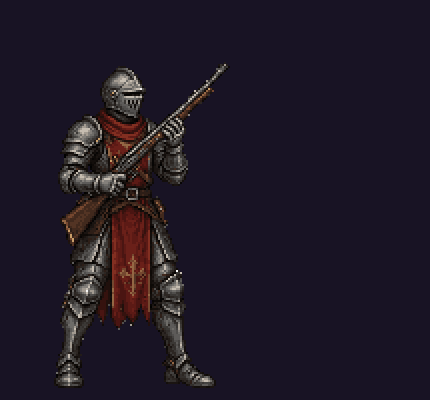
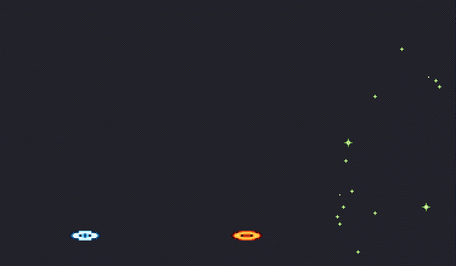
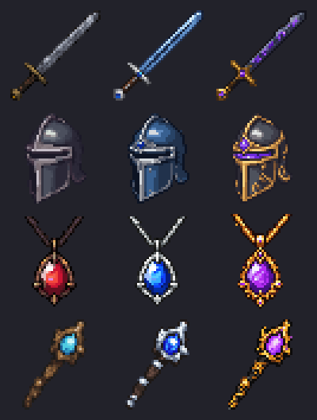
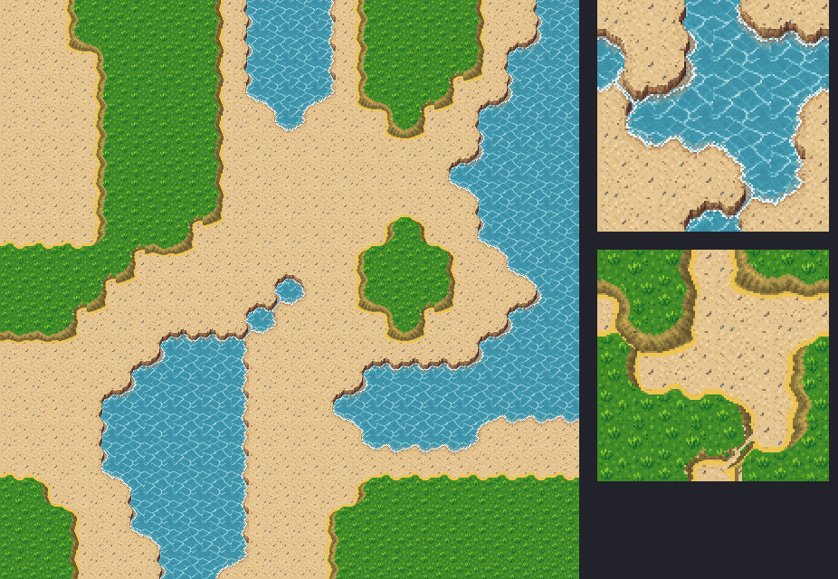
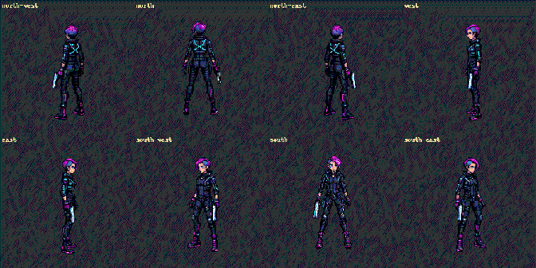
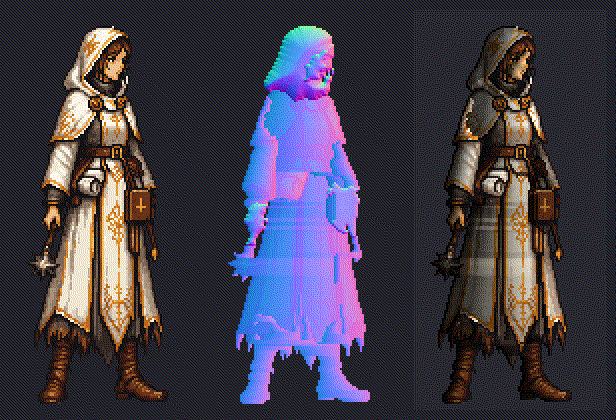

# pixellab-game-art

Make pixel-art game assets with [PixelLab](https://pixellab.ai) by talking to your AI assistant -
sprites, backgrounds, buildings, icons, attack animations and effects - with clear steps, the cost
of every job shown up front, and plain-language results. Built for people who have never used
PixelLab before; deep enough to keep using after.

## What it makes

All of these were made with this skill and PixelLab - no hand-drawing.

| | |
|---|---|
|  |  |
| **Attack animation** - wind-up, shot, recovery, made from one sprite. `/pga-anim knight.png rifle shot` | **Spell effects** - painted VFX clips with game-ready timing. `/pga-vfx frost cast` |
|  |  |
| **Item icons + rare/epic tiers.** `/pga-icon steel sword --tiers` | **Terrain that autotiles** - sea, beach and grass from two chained tilesets (left: a test map, right: the sheets). `/pga-tiles sea > beach > grass` |
|  |  |
| **8 directions** for top-down games, one attack per facing. `/pga-anim hero.png laser shot --dirs 8` | **Normal maps** - the sprite, its map, and a game light moving around it. `/pga-normal cleric.png` |

## Start here (no experience needed)

**What you need**
- A Windows or Mac computer.
- An **AI assistant** that can work with files on your computer. The easiest is the
  [Claude desktop app](https://claude.ai/download) (its **Code** tab; needs a paid Claude plan).
  Others work too - see "Pick your version" below.
- A **PixelLab** account - [pixellab.ai](https://pixellab.ai), free to start. PixelLab is the service that draws
  the art; it counts work in **generations** (a small sprite is ~5, a big picture ~25).

**Steps**
1. On this page click the green **Code** button → **Download ZIP**. Unzip it (Windows: right-click →
   *Extract All…*; Mac: double-click). You get a folder called `pixellab-game-art-main`.
2. Open the Claude desktop app → **Code** tab → start a new session and pick that folder.
3. Send this message: **Set up the PixelLab skill for me - follow SETUP_FOR_AI.md.**
4. The assistant does the setup. It asks you for three small things only:
   - install Python if you don't have it (it gives you the link);
   - copy your PixelLab **token** (a private key, like a password) from https://api.pixellab.ai/mcp;
   - run **one** command it gives you, with your token pasted into it. Never paste the token into the chat.
5. Start a new session, this time in your game's folder (any folder is fine).
6. Type **`/pga-start`**. It makes three first pieces of art with you, explaining each step and its cost
   before it runs.

Something not working? Type **`/pga-doctor`** - it checks everything and tells you the fix in plain words.

## Pick your version

| You use | Folder |
|---|---|
| **Claude Code** (desktop app or terminal) | [`claude-code/`](claude-code/) - slash commands (`/pga-start`, `/pga-char`, …) |
| **Codex, Gemini CLI, Cursor, GitHub Copilot, OpenCode** or another agent | [`any-agent/`](any-agent/) - the same skill in the open Agent Skills format |

Using another assistant? Do steps 1, 3-6 above, but open it inside the folder first:

| You use | Open it in the folder |
|---|---|
| **Claude Code** in a terminal | Open a terminal in the folder (below), type `claude`, press Enter. |
| **Codex CLI** / **Gemini CLI** / **OpenCode** | Open a terminal in the folder (below), type `codex` / `gemini` / `opencode`, press Enter. |
| **Cursor** / **VS Code** (Copilot) | *File → Open Folder…* → pick the folder, then open the chat (agent) panel. |

*Open a terminal in a folder:* **Windows** - open the folder in File Explorer, click the address bar, type
`cmd`, press Enter. **Mac** - right-click the folder in Finder → *New Terminal at Folder*. Outside
Claude Code, type the commands without the slash: `pga-start`, `pga-doctor`.

Each folder's README has the manual setup, every command, costs and waits, a glossary, engine import
notes and the privacy note (sharing results with the authors is off unless you turn it on).

## What it does for you

- Turns a short idea into a good PixelLab prompt in your game's style (or one copied from your art).
- Shows each PixelLab call and its cost before it runs; never repeats a paid call.
- Checks results automatically before you see them; explains problems in plain words.
- Remembers several named art styles per project; matches new art to art you approved.
- Picks cheaper AI models for simple steps; works on PixelLab's free trial and every plan.

## Keeping up with PixelLab

When PixelLab adds a feature to its tools, the skill is tested against it and updated - the
[CHANGELOG](CHANGELOG.md) has a "PixelLab updates" part in those entries saying what changed at
PixelLab and what the skill does with it. Latest (PixelLab 0.4.130, October 2026): Tileset Pro
(`/pga-tiles`), normal maps (`/pga-normal`), target colour palettes for Create Image Pro.

## Updates

The skill is updated weekly. Already installed? Tell your assistant **`pga-update`** - it downloads
the new version and merges it into your install, keeping any skill file you changed (`pga-update undo`
goes back). Your styles and generated art are never touched.

## Your data: consent first, lessons shared weekly

- **Nothing is sent unless you say yes.** Setup asks once; the answer is off by default. You choose
  `stats` (numbers and settings only) or `prompts` (plus your prompt text), and can preview, switch
  off or delete everything you sent at any time (`/pga-feedback`).
- Never sent: your PixelLab token, images, file paths, uploads or job ids.
- **Every week, what the shared results teach is folded back into the skill for all users** - better
  prompts, safer settings, new pitfall notes. Each weekly [CHANGELOG](CHANGELOG.md) entry lists what changed
  because of shared data and how many shared jobs it came from. Raw records are never published.

Details: the "Privacy" section in each folder's README.

The skill is MIT-licensed ([LICENSE](LICENSE)). Assets you make fall under [PixelLab's terms](https://pixellab.ai/termsofservice). Changes: [CHANGELOG.md](CHANGELOG.md).
